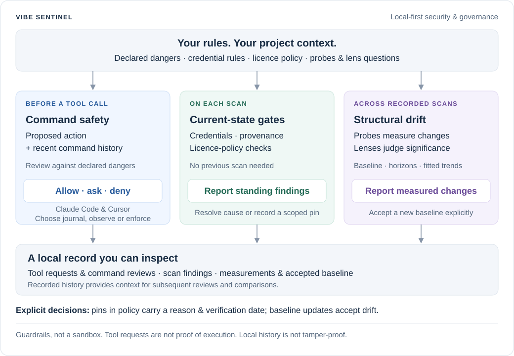

# Vibe Sentinel

Vibe Sentinel helps teams see what AI coding agents change in a repository and
review actions before they run. It records structural drift, flags credentials
and dependency provenance issues, checks licence policy, and can enforce
project rules on supported agent actions.

- **Run your first CLI scan.** Install Sentinel, check your model backend, and
  record a baseline. [Getting Started](docs/getting-started.md)
- **Set up the Codex plugin.** The development preview offers ten MCP tools,
  two skills for setup and inspection, and an optional safety hook. Install it
  from this checkout and review the hook in Codex before trusting it.
  [Codex plugin setup](docs/codex-plugin.md)
- **Run local JS/TS security checks.** In the development checkout, select an
  npm lockfile, a source directory, or an existing Next.js static export.
  Set up persistent tools and advisory data once, then scan offline. [Security checks](docs/security-checks.md)

## Why use it?

A code review sees the final diff. Sentinel also shows what an agent attempted
to run, what dependencies it brought in, and how the repository changed across
many edits. Teams can declare which actions need scrutiny, which licences they
accept, and which structural changes matter to them.

| When | What Sentinel records |
| --- | --- |
| Before an agent action | The request and, when safety review is enabled, a verdict under your declared policy |
| On every scan | Credential, dependency provenance and licence findings in the current tree or measured environment |
| Across scans | Changes to measured structure and installed dependencies, compared with a baseline and longer-term history |

Probes measure structure. A configured model answers questions about those
measurements and adjudicates candidates selected by the gates. The model can
rate a measured change and explain it. The probe comparison determines which
changes appear. [Drift](docs/drift.md) · [Model responsibilities](docs/use-of-local-model.md)



## What a finding looks like

```text
Drift since 2026-09-01T15:59:11+00:00
  ~ [medium] version:requests: 2.32.5 -> 2.28.0
      The installed version changed between scans.
```

The first scan with complete drift measurements establishes the baseline for
later comparisons. State gates can report current findings on that first scan.
In the development checkout, a later scan can exit with code 2 when a stage
fails or the comparison lacks data.
Accepting a new baseline changes future comparisons. A state-gate exception
requires its own decision and a scoped pin. [Scan outcomes](docs/getting-started.md#read-the-scan-outcome) · [Pins](docs/gates.md#pins-are-not-ignores)

## Availability and rollout

The repository's **0.5.1 release** includes `status`, Cursor support, explicit
hook modes and managed policy. The Codex plugin, optional ecosystem readers,
version 3 evidence exports, offline viewer and CI summaries are available in
the development checkout. [Changelog](CHANGELOG.md) · [Development setup](docs/development.md#setup)

Sentinel runs on Python 3.13 and uses a reachable OpenAI-compatible model
backend. You can install Sentinel separately from the application and select
the application's Python environment explicitly for dependency and licence
measurements. [Measured environments](docs/environments.md)

For a team rollout, record a baseline, define state-gate policies, and start
the safety hook in `observe` mode. Review recorded verdicts before enabling
`enforce`. Assign responsibility for findings and pins, and back up the history
if you rely on it for review. Managed policy can set a minimum safety mode on
centrally administered machines. [Safety modes and managed policy](docs/gates.md#command-safety) · [History maintenance](docs/database.md)

Use Sentinel alongside code review, tests, type checking and vulnerability
scanners. Model verdicts can vary, and a local journal records requests before
execution. Teams that need a protected audit trail should keep independent
logs and access controls. [Threat model](docs/THREAT_MODEL.md) · [Evaluations](docs/evals.md)

## Documentation

| I want to… | Guides |
| --- | --- |
| Install and scan | [CLI setup](docs/getting-started.md) · [Codex plugin](docs/codex-plugin.md) · [Measured environments](docs/environments.md) |
| Protect agent actions and review findings | [Gates and policies](docs/gates.md) · [Threat model](docs/THREAT_MODEL.md) · [Control mapping](docs/CONTROL_MAPPING.md) |
| Measure Python code | [Python relationships](docs/python-relationships.md) |
| Measure JavaScript, TypeScript or a frontend build | [Support matrix](docs/frontend-support.md) · [Starter profiles](docs/starter-profiles.md) · [JavaScript pack](docs/javascript-pack.md) · [Vite builds](docs/vite-builds.md) |
| Check JavaScript or TypeScript security evidence | [Local security checks](docs/security-checks.md) |
| Measure API contracts, migrations or jobs | [OpenAPI](docs/openapi.md) · [Alembic and JSON Schema](docs/backend-schemas.md) · [Celery jobs](docs/job-inventories.md) · [Runnable full-stack example](docs/fullstack-example.md) |
| Read or export results | [Drift and trends](docs/drift.md) · [Scan results and exports](docs/results.md) · [Offline viewer](docs/local-viewer.md) · [CI summaries](docs/ci-evidence.md) · [History database](docs/database.md) |
| Contribute or extend Sentinel | [Development](docs/development.md) · [Development plugin](plugins/development/README.md) · [Add a probe](docs/adding-a-probe.md) · [Pack contract](docs/pack-contract.md) · [Run evaluations](docs/evals.md) · [Historical eval results](docs/eval-results.md) · [Benchmarks](benchmarks/README.md) · [Roadmap](docs/roadmap.md) · [Report a vulnerability](SECURITY.md) |

## License

MIT
